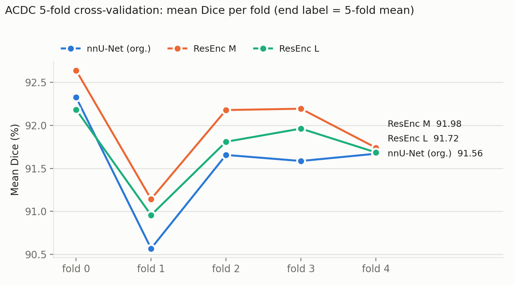
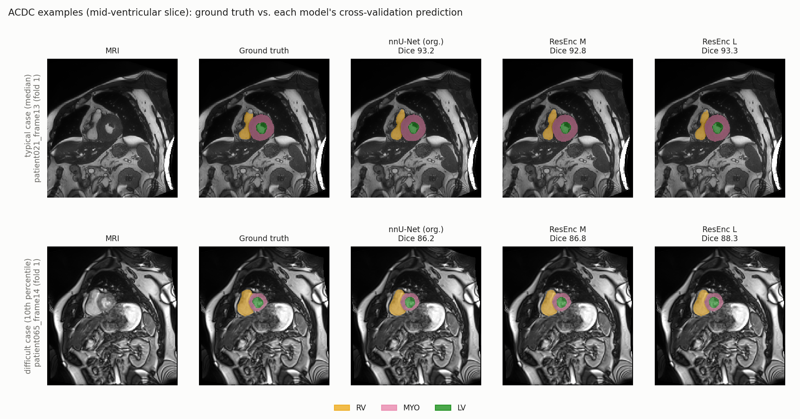

# nnU-Net Revisited on ACDC: an independent reproduction

Independent reproduction of the ACDC results in **nnU-Net Revisited** (Isensee et al., MICCAI 2024)
for three of the paper's configurations: the original nnU-Net, nnU-Net ResEnc M and nnU-Net ResEnc L.
Training and evaluation ran on 2× NVIDIA RTX 6000 Ada (48 GB) and follow the paper's protocol:
5-fold cross-validation on the ACDC training set, using nnU-Net's own patient-level splits.

> **Status (October 2026): complete.** All 15 trainings (3 models × 5 folds) finished. All three
> models reproduce the paper's ACDC Dice within **0.03 points** (at most 0.06 of a fold standard
> deviation) and its NSD within **0.08 points**.

## Paper

- F. Isensee, T. Wald, C. Ulrich, M. Baumgartner, S. Roy, K. Maier-Hein, P. F. Jäger.
  *nnU-Net Revisited: A Call for Rigorous Validation in 3D Medical Image Segmentation.* MICCAI 2024.
  [arXiv:2404.09556](https://arxiv.org/abs/2404.09556)
- Official code (Apache-2.0): <https://github.com/MIC-DKFZ/nnUNet>

## What is reproduced, and what is not

| Item | Paper | This repo |
|---|---|---|
| Dataset | ACDC, 100 training patients (200 ED/ES volumes) | same, downloaded from the official CREATIS server |
| Models | nnU-Net (org.), ResEnc M / L / XL, MedNeXt, STU-Net, SwinUNETR, U-Mamba, ... | **nnU-Net (org.), ResEnc M, ResEnc L only** |
| Configuration | `3d_fullres` | `3d_fullres` |
| Split | 5-fold CV, splits generated by nnU-Net | nnU-Net's official ACDC split (`create_ACDC_split`, patient-level, seed 1234), checked for leakage |
| Training | nnU-Net defaults (1000 epochs) | nnU-Net defaults, unmodified trainer |
| Metrics | DSC (and NSD @ 2 mm), averaged over classes and folds | DSC per class (RV, MYO, LV), mean ± SD over folds; NSD @ 2 mm with the same library as the paper |
| Framework | nnU-Net v2 (version used in the paper not pinned here) | nnU-Net v2.8.1 (see *Deviations*) |

Not reproduced: ResEnc XL, MedNeXt, STU-Net, SwinUNETR, U-Mamba, and the other datasets in the paper.

## Results

### Main table (5-fold cross-validation, ACDC, %)

| Model | Dice RV | Dice MYO | Dice LV | **Mean Dice** (± SD over folds) | Paper Dice | Gap to paper | NSD @ 2 mm | Paper NSD |
|---|---|---|---|---|---|---|---|---|
| nnU-Net (org.) | 90.12 | 89.96 | 94.61 | **91.56 ± 0.63** | 91.54 | +0.02 (0.03 SD) | 94.94 ± 0.73 | 94.93 |
| nnU-Net ResEnc M | 90.77 | 90.27 | 94.90 | **91.98 ± 0.57** | 91.99 | −0.01 (0.02 SD) | 95.53 ± 0.69 | 95.50 |
| nnU-Net ResEnc L | 90.50 | 89.97 | 94.69 | **91.72 ± 0.47** | 91.69 | +0.03 (0.06 SD) | 95.19 ± 0.55 | 95.11 |

Paper values: Dice from Table 1, NSD from Table 4. The paper reports class-averaged values only; the
per-class Dice is an extra output of this reproduction. Aggregation follows the paper: per fold, the mean
over cases and over the three classes; then mean ± SD over the five folds. `evaluate_acdc.py` computes
Dice independently and matches nnU-Net's own `summary.json` for every fold (max difference 0.000 points).

### Per fold (mean Dice, %)

| Model | Fold 0 | Fold 1 | Fold 2 | Fold 3 | Fold 4 |
|---|---|---|---|---|---|
| nnU-Net (org.) | 92.33 | 90.57 | 91.66 | 91.59 | 91.67 |
| nnU-Net ResEnc M | 92.64 | 91.14 | 92.18 | 92.19 | 91.74 |
| nnU-Net ResEnc L | 92.18 | 90.96 | 91.81 | 91.96 | 91.69 |



### Comparing the models (applying the rule set out before training)

Before training I committed to not claiming a ranking between models unless the difference exceeds the
fold-to-fold SD (about 0.5–0.6 Dice points). None of the differences does:

| Comparison | Mean difference | Folds in favour | Larger than fold SD? |
|---|---|---|---|
| ResEnc M − nnU-Net (org.) | +0.41 (paper: +0.45) | 5 / 5 | no |
| ResEnc M − ResEnc L | +0.26 (paper: +0.30) | 5 / 5 | no |
| ResEnc L − nnU-Net (org.) | +0.16 (paper: +0.15) | 4 / 5 | no |

So the honest summary is: **the three models are within one fold SD of each other**, which is itself
the paper's ACDC finding. The *direction* of every difference matches the paper, and ResEnc M is ahead of
both other models on every single fold, but with five folds this is consistent, not statistically
established. The larger ResEnc L does not improve over ResEnc M on this small dataset.

The hardest structures are the myocardium (a thin ring) and the right ventricle (irregular shape);
the left-ventricle cavity is the easiest.



*Mid-ventricular slice of a typical case (median ResEnc M Dice) and a difficult case (10th percentile),
each model's own cross-validation prediction. Images: ACDC (Bernard et al., 2018).*

### Models as planned by nnU-Net (`3d_fullres`)

| Model | Network | Patch size | Batch | Target spacing (mm) | Encoder blocks per stage |
|---|---|---|---|---|---|
| nnU-Net (org.) | PlainConvUNet | 20 × 256 × 224 | 4 | 5 × 1.56 × 1.56 | 2, 2, 2, 2, 2, 2 |
| ResEnc M | ResidualEncoderUNet | 20 × 256 × 224 | 3 | 5 × 1.56 × 1.56 | 1, 3, 4, 6, 6, 6 |
| ResEnc L | ResidualEncoderUNet | 20 × 256 × 224 | 10 | 5 × 1.56 × 1.56 | 1, 3, 4, 6, 6, 6 |

The ResEnc L plan is identical to the one in the paper's Table 5 (patch 20 × 256 × 224, spacing
5 × 1.56 × 1.56, batch 10).

### Compute

| | Paper (A100 40 GB) | This repo (RTX 6000 Ada 48 GB) |
|---|---|---|
| nnU-Net (org.) | 7.70 GB VRAM, 9 GPU-h | not recorded |
| ResEnc M | 9.10 GB VRAM, 12 GPU-h | ≈ 9 GB, ≈ 44 s/epoch ≈ 12 h per fold |
| ResEnc L | 22.70 GB VRAM, 35 GPU-h | ≈ 27 GB, ≈ 140 s/epoch ≈ 39 h per fold |

My memory figures are what `nvidia-smi` shows, which includes the CUDA context and PyTorch's cache, so they
are not directly comparable with the paper's VRAM column. The paper does not state whether its runtime is
per fold or per dataset.

## Repository layout

| Path | Step | What it does |
|---|---|---|
| `scripts/download_acdc.py` | 1 | Resumable download of the ACDC ED/ES frames + labels from the official CREATIS Girder server (standard library only) |
| `scripts/step2_convert.sh` | 2 | Converts to nnU-Net format, writes the official 5-fold split, asserts no patient leakage, extracts the dataset fingerprint |
| `scripts/convert_acdc.py` | 2 | Runs nnU-Net's own `Dataset027_ACDC` converter, with a workaround for a v2.8.1 path bug (see *Deviations*) |
| `scripts/step3_plan_preprocess.sh` | 3 | Plans the three models and preprocesses `3d_fullres` once |
| `scripts/train_queue.sh` | 4 | Resumable training queue: one worker per GPU, 15 jobs (3 models × 5 folds), file locks, retry limit |
| `scripts/train_status.py` | 4 | Read-only status of all 15 jobs (epoch, s/epoch, ETA, best pseudo-Dice) |
| `scripts/evaluate_acdc.py` | 5 | Dice and NSD per class, per fold, mean ± SD over folds; writes `results/` |
| `scripts/make_figures.py` | 5 | The two figures in this README |
| `results/` | – | `results_table.md`, `results_summary.json`, `figures/` |
| `env.sh.example` | – | Environment variables the scripts expect |

## Setup

Tested on Ubuntu 22.04, NVIDIA driver 535 (CUDA ≤ 12.2), so PyTorch is installed from the cu121 wheels.

```bash
conda create -n nnunet python=3.10 -y && conda activate nnunet
pip install torch --index-url https://download.pytorch.org/whl/cu121
pip install -r requirements.txt

mkdir -p ~/nnunet_repro && cp env.sh.example ~/nnunet_repro/env.sh   # then edit the paths
cp -r scripts ~/nnunet_repro/
source ~/nnunet_repro/env.sh
```

Environment the results above were produced with: Python 3.10.20, PyTorch 2.5.1 (CUDA 12.1 build),
nnU-Net v2.8.1 (commit `468cf803df9b267150ae2b6c0c59b8ac84f16227`), 2× RTX 6000 Ada, driver 535.183.01,
32 CPU threads, 251 GB RAM.

## Data

ACDC is **not redistributed here**. It is available from the official challenge site
(<https://www.creatis.insa-lyon.fr/Challenge/acdc/>) under its own terms.

```bash
python ~/nnunet_repro/scripts/download_acdc.py --out ~/nnunet_repro/downloads/ACDC
```

The script skips the 4D cine volumes and the test set, which the paper's cross-validation does not use.

## Run

Each step is safe to re-run. Finished parts are skipped.

```bash
bash ~/nnunet_repro/scripts/step2_convert.sh <ACDC root printed by the download script>
bash ~/nnunet_repro/scripts/step3_plan_preprocess.sh

# one worker per GPU, each inside its own tmux session so training survives a dropped VPN/SSH session
tmux new -s gpu0 'bash ~/nnunet_repro/scripts/train_queue.sh 0'
tmux new -s gpu1 'bash ~/nnunet_repro/scripts/train_queue.sh 1'
python ~/nnunet_repro/scripts/train_status.py           # check progress at any time

python ~/nnunet_repro/scripts/evaluate_acdc.py --out results   # works on finished folds only
python ~/nnunet_repro/scripts/make_figures.py --results results
```

Training resumes from `checkpoint_latest.pth` (`--c`), so a reboot or a lost connection costs at most
the epochs since the last checkpoint (saved every 50 epochs).

## Deviations from the paper

- **nnU-Net version.** I use v2.8.1. In that version, `nnunetv2.paths` returns path objects that
  `Dataset027_ACDC.make_out_dirs()` cannot handle (`AttributeError: '_EnvPath' object has no attribute
  'replace'`), so `convert_acdc.py` passes plain strings and then runs the converter's own logic unchanged.
  The split is the same official one.
- **Shared preprocessing.** The ResEnc presets reuse the default plans' `3d_fullres` preprocessed data
  (same target spacing and normalization), so preprocessing runs once.
- **Fewer models.** Three of the paper's configurations, chosen to fit the time budget.
- **Hardware and software.** RTX 6000 Ada instead of A100, and newer PyTorch / nnU-Net; training time and
  memory are therefore not directly comparable.

## Limitations

- One run per fold, as in the paper. Fold-to-fold SD is the only variance estimate; seed-to-seed
  variance was not measured.
- Cross-validation on the training set only. Like the paper, there is no separate held-out test set.
- Five folds are too few to establish the ranking between models statistically (see above).
- Results apply to ACDC and to these three configurations only.

## Citation

```bibtex
@inproceedings{isensee2024nnunetrevisited,
  title     = {nnU-Net Revisited: A Call for Rigorous Validation in 3D Medical Image Segmentation},
  author    = {Isensee, Fabian and Wald, Tassilo and Ulrich, Constantin and Baumgartner, Michael and
               Roy, Saikat and Maier-Hein, Klaus and J{\"a}ger, Paul F.},
  booktitle = {Medical Image Computing and Computer Assisted Intervention (MICCAI)},
  year      = {2024}
}

@article{bernard2018acdc,
  title   = {Deep Learning Techniques for Automatic MRI Cardiac Multi-Structures Segmentation and
             Diagnosis: Is the Problem Solved?},
  author  = {Bernard, Olivier and others},
  journal = {IEEE Transactions on Medical Imaging},
  volume  = {37}, number = {11}, pages = {2514--2525},
  year    = {2018}
}
```

## License

Scripts in this repository: MIT (see `LICENSE`). nnU-Net itself is Apache-2.0. ACDC has its own terms of use.
