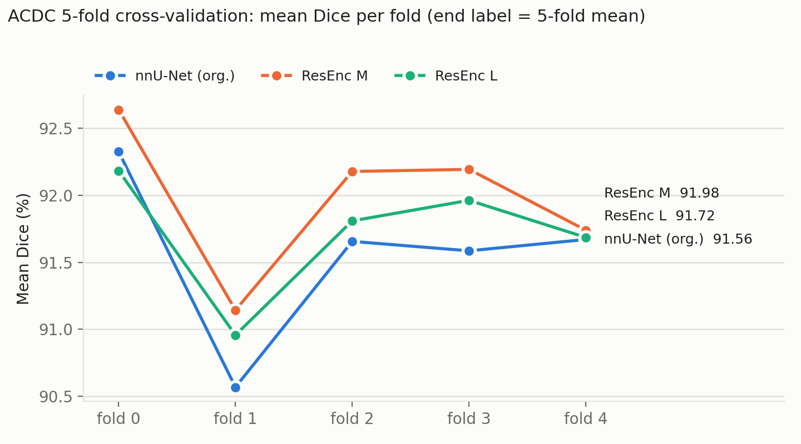
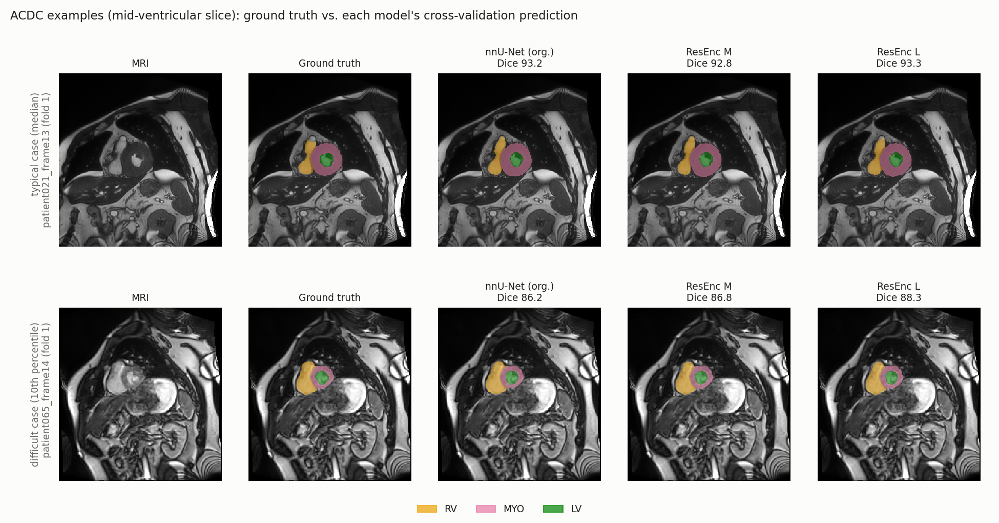

# nnU-Net Revisited on ACDC: an independent reproduction

Independent reproduction of the ACDC results in **nnU-Net Revisited** (Isensee et al., MICCAI 2024)
for five of the paper's configurations: three CNNs (the original nnU-Net, nnU-Net ResEnc M and ResEnc L),
one Mamba-based network (U-Mamba Bot) and one Transformer-based network (SwinUNETR).
Training and evaluation ran on 2× NVIDIA RTX 6000 Ada (48 GB) and follow the paper's protocol:
5-fold cross-validation on the ACDC training set, using nnU-Net's own patient-level splits.

> - The three nnU-Net models reproduce the paper's ACDC Dice within **0.03 points** (at most 0.06 of a fold
>   standard deviation) and its NSD within **0.08 points**.
> - U-Mamba Bot is within **0.16 Dice points** (0.28 fold SD) and **0.34 NSD points** of the paper.
> - SwinUNETR is **not reproduced**: 2.88 Dice points below the paper (2.7 fold SD), with the setup
>   differences listed under *Deviations*.

## Paper

- F. Isensee, T. Wald, C. Ulrich, M. Baumgartner, S. Roy, K. Maier-Hein, P. F. Jäger.
  *nnU-Net Revisited: A Call for Rigorous Validation in 3D Medical Image Segmentation.* MICCAI 2024.
  [arXiv:2404.09556](https://arxiv.org/abs/2404.09556)
- Official code (Apache-2.0): <https://github.com/MIC-DKFZ/nnUNet>
- U-Mamba and SwinUNETR were trained with the official U-Mamba code (Apache-2.0):
  <https://github.com/bowang-lab/U-Mamba>

## What is reproduced, and what is not

| Item | Paper | This repo |
|---|---|---|
| Dataset | ACDC, 100 training patients (200 ED/ES volumes) | downloaded from the official CREATIS server |
| Models | nnU-Net (org.), ResEnc M / L / XL, MedNeXt, STU-Net, SwinUNETR, U-Mamba, ... | **nnU-Net (org.), ResEnc M, ResEnc L, U-Mamba Bot, SwinUNETR** |
| Configuration | `3d_fullres` | `3d_fullres` |
| Split | 5-fold CV, splits generated by nnU-Net | nnU-Net's official ACDC split (`create_ACDC_split`, patient-level, seed 1234), checked for leakage; the identical split file is used for all five models |
| Training | nnU-Net defaults (1000 epochs) | nnU-Net defaults for the CNNs and U-Mamba; U-Mamba's own SwinUNETR trainer (see *Deviations*) |
| Metrics | DSC (and NSD @ 2 mm), averaged over classes and folds | DSC per class (RV, MYO, LV), mean ± SD over folds; NSD @ 2 mm with the same library as the paper |
| Framework | nnU-Net v2 (version used in the paper not pinned here) | nnU-Net v2.8.1 for the CNNs; U-Mamba's bundled nnU-Net v2.1.1 for U-Mamba and SwinUNETR (see *Deviations*) |

Not reproduced: ResEnc XL, U-Mamba Enc, MedNeXt, STU-Net, SwinUNETRV2, nnFormer, CoTr, and the other
datasets in the paper.

## Results

### Main table (5-fold cross-validation, ACDC, %)

| Model | Type | Dice RV | Dice MYO | Dice LV | **Mean Dice** (± SD over folds) | Paper Dice | Gap to paper | NSD @ 2 mm | Paper NSD |
|---|---|---|---|---|---|---|---|---|---|
| nnU-Net (org.) | CNN | 90.12 | 89.96 | 94.61 | **91.56 ± 0.63** | 91.54 | +0.02 (0.03 SD) | 94.94 ± 0.73 | 94.93 |
| nnU-Net ResEnc M | CNN | 90.77 | 90.27 | 94.90 | **91.98 ± 0.57** | 91.99 | −0.01 (0.02 SD) | 95.53 ± 0.69 | 95.50 |
| nnU-Net ResEnc L | CNN | 90.50 | 89.97 | 94.69 | **91.72 ± 0.47** | 91.69 | +0.03 (0.06 SD) | 95.19 ± 0.55 | 95.11 |
| U-Mamba Bot | Mamba | 90.31 | 89.95 | 94.62 | **91.63 ± 0.58** | 91.79 | −0.16 (0.28 SD) | 95.06 ± 0.66 | 95.40 |
| SwinUNETR | Transformer | 85.52 | 86.67 | 93.04 | **88.41 ± 1.05** | 91.29 | **−2.88 (2.74 SD)** | 90.96 ± 1.07 | 94.12 |

Paper values: Dice from Table 1, NSD from Table 4. The paper reports class-averaged values only; the
per-class Dice is an extra output of this reproduction. Aggregation follows the paper: per fold, the mean
over cases and over the three classes; then mean ± SD over the five folds. `evaluate_all.py` computes Dice
independently and matches each model's own nnU-Net `summary.json` for every fold (max difference 0.000 points).
All five models were evaluated on exactly the same validation cases per fold (checked by the script).

### Per fold (mean Dice, %)

| Model | Fold 0 | Fold 1 | Fold 2 | Fold 3 | Fold 4 |
|---|---|---|---|---|---|
| nnU-Net (org.) | 92.33 | 90.57 | 91.66 | 91.59 | 91.67 |
| nnU-Net ResEnc M | 92.64 | 91.14 | 92.18 | 92.19 | 91.74 |
| nnU-Net ResEnc L | 92.18 | 90.96 | 91.81 | 91.96 | 91.69 |
| U-Mamba Bot | 92.25 | 90.68 | 91.88 | 91.73 | 91.59 |
| SwinUNETR | 87.26 | 87.53 | 89.89 | 88.61 | 88.76 |



*The figure shows the three nnU-Net models; U-Mamba Bot and SwinUNETR are in the tables.*

### Comparing the models (applying the rule set out before training)

Before training I committed to not claiming a ranking between models unless the difference exceeds the
fold-to-fold SD (about 0.5–0.6 Dice points for the nnU-Net baseline). Paired on the same folds, against the
original nnU-Net:

| Comparison | Mean difference | Folds in favour | Paper difference | Larger than fold SD? |
|---|---|---|---|---|
| ResEnc M − nnU-Net (org.) | +0.42 | 5 / 5 | +0.45 | no |
| ResEnc L − nnU-Net (org.) | +0.16 | 4 / 5 | +0.15 | no |
| U-Mamba Bot − nnU-Net (org.) | +0.07 | 3 / 5 | +0.25 | no |
| SwinUNETR − nnU-Net (org.) | −3.15 | 0 / 5 | −0.25 | **yes** |
| ResEnc M − ResEnc L | +0.26 | 5 / 5 | +0.30 | no |

What this supports:

- **The three CNNs and U-Mamba Bot are within one fold SD of each other.** In particular, U-Mamba Bot is
  practically identical to the original nnU-Net (+0.07 on average, ahead on 3 of 5 folds), even closer than
  in the paper (+0.25). This is consistent with the paper's central claim that the Mamba-based model does not
  beat a well-configured CNN baseline. ResEnc M is ahead of all other models on every fold, but with five
  folds this is consistent, not statistically established.
- **SwinUNETR is clearly worse here** (−3.15 on average, lower on every fold) — a much larger gap than the
  paper's −0.25. The direction agrees with the paper (SwinUNETR below the CNNs), but the size does not, and
  this run uses a different SwinUNETR setup from the paper's own integration (see *Deviations*). I therefore
  report it as **not reproduced** and do not attribute the gap to the architecture itself. The largest loss is
  on the right ventricle (85.52 vs 90.12 for nnU-Net) and the myocardium (86.67 vs 89.96).

The hardest structures for all models are the myocardium (a thin ring) and the right ventricle (irregular
shape); the left-ventricle cavity is the easiest.



*Mid-ventricular slice of a typical case (median ResEnc M Dice) and a difficult case (10th percentile),
each model's own cross-validation prediction. Images: ACDC (Bernard et al., 2018).*

### Models as planned by nnU-Net (`3d_fullres`)

| Model | Network | Patch size | Batch | Target spacing (mm) | Encoder blocks per stage |
|---|---|---|---|---|---|
| nnU-Net (org.) | PlainConvUNet | 20 × 256 × 224 | 4 | 5 × 1.56 × 1.56 | 2, 2, 2, 2, 2, 2 |
| ResEnc M | ResidualEncoderUNet | 20 × 256 × 224 | 3 | 5 × 1.56 × 1.56 | 1, 3, 4, 6, 6, 6 |
| ResEnc L | ResidualEncoderUNet | 20 × 256 × 224 | 10 | 5 × 1.56 × 1.56 | 1, 3, 4, 6, 6, 6 |
| U-Mamba Bot | UMambaBot | 20 × 256 × 224 | 4 | 5 × 1.56 × 1.56 | nnU-Net default plan + Mamba block at the bottleneck |
| SwinUNETR | MONAI SwinUNETR | 32 × 256 × 224 (padded) | 3 | 5 × 1.56 × 1.56 | Swin Transformer encoder, feature size 48 |

The ResEnc L plan is identical to the one in the paper's Table 5 (patch 20 × 256 × 224, spacing
5 × 1.56 × 1.56, batch 10). U-Mamba's nnU-Net v2.1.1 produced the same default plan as nnU-Net v2.8.1
(patch, batch, spacing and number of stages all identical), so U-Mamba Bot and the original nnU-Net differ
only in the network.

### Compute

| | Paper (A100 40 GB) | This repo (RTX 6000 Ada 48 GB) |
|---|---|---|
| nnU-Net (org.) | 7.70 GB VRAM, 9 GPU-h | not recorded |
| ResEnc M | 9.10 GB VRAM, 12 GPU-h | ≈ 9 GB, ≈ 44 s/epoch ≈ 12 h per fold |
| ResEnc L | 22.70 GB VRAM, 35 GPU-h | ≈ 27 GB, ≈ 140 s/epoch ≈ 39 h per fold |
| U-Mamba Bot | – | ≈ 15 GB, ≈ 98 s/epoch ≈ 27 h per fold |
| SwinUNETR (batch 3, fp32) | – | ≈ 39 GB, ≈ 254 s/epoch ≈ 71 h per fold |

My memory figures are what `nvidia-smi` shows, which includes the CUDA context and PyTorch's cache, so they
are not directly comparable with the paper's VRAM column. The paper does not state whether its runtime is
per fold or per dataset.

## Repository layout

| Path | Step | What it does |
|---|---|---|
| `scripts/download_acdc.py` | 1 | Resumable download of the ACDC ED/ES frames + labels from the official CREATIS Girder server (standard library only) |
| `scripts/step2_convert.sh` | 2 | Converts to nnU-Net format, writes the official 5-fold split, asserts no patient leakage, extracts the dataset fingerprint |
| `scripts/convert_acdc.py` | 2 | Runs nnU-Net's own `Dataset027_ACDC` converter, with a workaround for a v2.8.1 path bug (see *Deviations*) |
| `scripts/step3_plan_preprocess.sh` | 3 | Plans the three nnU-Net models and preprocesses `3d_fullres` once |
| `scripts/train_queue.sh` | 4 | Resumable training queue: one worker per GPU, 15 jobs (3 models × 5 folds), file locks, retry limit |
| `scripts/train_status.py` | 4 | Read-only status of all 15 jobs (epoch, s/epoch, ETA, best pseudo-Dice) |
| `scripts/evaluate_acdc.py` | 5 | Dice and NSD for the three nnU-Net models; writes `results/results_table.md` |
| `scripts/evaluate_all.py` | 5 | Dice and NSD for all five models in one table, plus the paired comparison; writes `results/results_table_all.md` |
| `scripts/make_figures.py` | 5 | The two figures in this README |
| `umamba/setup_umamba.sh` | U1 | Separate environment for U-Mamba (bundled nnU-Net 2.1.1), Mamba CUDA kernels, same split |
| `umamba/check_umamba.py` | U1 | GPU and installation checks (Mamba layer, SwinUNETR, paths, split) |
| `umamba/step2_umamba.sh` | U2 | Plans and preprocesses with nnU-Net 2.1.1 and compares the plan with the 2.8.1 runs |
| `umamba/smoke_umamba.py` | U2 | Memory and speed check of U-Mamba Bot / Enc and SwinUNETR before training |
| `umamba/train_queue_umamba.sh` | U3 | Resumable training queue for U-Mamba Bot / Enc and SwinUNETR |
| `umamba/train_status_umamba.py` | U3 | Read-only status of those jobs |
| `results/` | – | `results_table.md`, `results_table_all.md`, `results_summary*.json`, `figures/` |
| `env.sh.example` | – | Environment variables the nnU-Net scripts expect |

## Setup

Tested on Ubuntu 22.04, NVIDIA driver 535 (CUDA ≤ 12.2), so PyTorch is installed from the cu121 wheels.

```bash
conda create -n nnunet python=3.10 -y && conda activate nnunet
pip install torch --index-url https://download.pytorch.org/whl/cu121
pip install -r requirements.txt

mkdir -p ~/nnunet_repro && cp env.sh.example ~/nnunet_repro/env.sh   # then edit the paths
cp -r scripts ~/nnunet_repro/
source ~/nnunet_repro/env.sh
```

Environment the nnU-Net results were produced with: Python 3.10.20, PyTorch 2.5.1 (CUDA 12.1 build),
nnU-Net v2.8.1 (commit `468cf803df9b267150ae2b6c0c59b8ac84f16227`), 2× RTX 6000 Ada, driver 535.183.01,
32 CPU threads, 251 GB RAM.

U-Mamba and SwinUNETR ran in a separate environment cloned from it, with U-Mamba at commit `28459e3`
(bundled nnU-Net v2.1.1), `mamba_ssm` 2.2.4, `causal_conv1d` 1.5.0.post8, MONAI 1.3.0 and `transformers` 4.46.3.
`umamba/setup_umamba.sh` builds this environment.

## Data

ACDC is **not redistributed here**. It is available from the official challenge site
(<https://www.creatis.insa-lyon.fr/Challenge/acdc/>) under its own terms.

```bash
python ~/nnunet_repro/scripts/download_acdc.py --out ~/nnunet_repro/downloads/ACDC
```

The script skips the 4D cine volumes and the test set, which the paper's cross-validation does not use.

## Run

Each step is safe to re-run. Finished parts are skipped.

```bash
# nnU-Net (org.), ResEnc M, ResEnc L
bash ~/nnunet_repro/scripts/step2_convert.sh <ACDC root printed by the download script>
bash ~/nnunet_repro/scripts/step3_plan_preprocess.sh

# one worker per GPU, each inside its own tmux session so training survives a dropped VPN/SSH session
tmux new -s gpu0 'bash ~/nnunet_repro/scripts/train_queue.sh 0'
tmux new -s gpu1 'bash ~/nnunet_repro/scripts/train_queue.sh 1'
python ~/nnunet_repro/scripts/train_status.py           # check progress at any time

# U-Mamba Bot and SwinUNETR (separate environment, same raw data and split)
cp umamba/*.sh umamba/*.py ~/umamba_repro/
bash ~/umamba_repro/setup_umamba.sh
bash ~/umamba_repro/step2_umamba.sh
tmux new -s ub0 'bash ~/umamba_repro/train_queue_umamba.sh 0 bot swin'
tmux new -s ub1 'bash ~/umamba_repro/train_queue_umamba.sh 1 bot swin'
python ~/umamba_repro/train_status_umamba.py

# evaluation (nnU-Net environment) and figures
python ~/nnunet_repro/scripts/evaluate_all.py --out results     # works on finished folds only
python ~/nnunet_repro/scripts/make_figures.py --results results
```

Training resumes from `checkpoint_latest.pth` (`--c`), so a reboot or a lost connection costs at most
the epochs since the last checkpoint (saved every 50 epochs).

## Deviations from the paper

**nnU-Net models**

- **nnU-Net version.** I use v2.8.1. In that version, `nnunetv2.paths` returns path objects that
  `Dataset027_ACDC.make_out_dirs()` cannot handle (`AttributeError: '_EnvPath' object has no attribute
  'replace'`), so `convert_acdc.py` passes plain strings and then runs the converter's own logic unchanged.
  The split is the same official one.
- **Shared preprocessing.** The ResEnc presets reuse the default plans' `3d_fullres` preprocessed data
  (same target spacing and normalization), so preprocessing runs once.

**U-Mamba Bot and SwinUNETR**

- **Code and version.** Official U-Mamba repository (commit `28459e3`), which bundles nnU-Net v2.1.1. The
  paper does not state which implementation or version it used for these models.
- **Paths.** U-Mamba's `nnunetv2/paths.py` ignores the `nnUNet_raw` / `nnUNet_preprocessed` /
  `nnUNet_results` environment variables and uses a hard-coded folder; three lines were changed so it reads
  the environment variables. Nothing else in U-Mamba's code was changed.
- **Package versions.** `transformers` pinned to 4.46.3, because `mamba_ssm` 2.2.4 imports a name
  (`GreedySearchDecoderOnlyOutput`) that `transformers` 5.x removed.
- **Same data and split.** ACDC was preprocessed again with nnU-Net 2.1.1 from the same raw data; the
  official split file was copied over before training and checked to be byte-identical.
- **SwinUNETR setup (the likely source of its gap; none of these was tested separately):**
  - U-Mamba's SwinUNETR trainer is used as published: AdamW (lr 8e-4, weight decay 0.01), cosine schedule,
    no deep supervision, full precision (fp32), gradient clipping. The paper's authors integrated SwinUNETR
    into nnU-Net themselves; their exact recipe is not given, so it may differ.
  - The trainer pads the patch from 20 to 32 slices (SwinUNETR needs sizes divisible by 32).
  - **Batch size 3 instead of the planned 4**, because batch 4 in fp32 did not fit in 48 GB of GPU memory.
    This is done with a separate plans file (`nnUNetPlans_bs3`) that differs from the default plan only in the
    batch size.

**General**

- **Fewer models.** Five of the paper's configurations, chosen to fit the time budget.
- **Hardware and software.** RTX 6000 Ada instead of A100, and newer PyTorch / nnU-Net; training time and
  memory are therefore not directly comparable.

## Limitations

- One run per fold, as in the paper. Fold-to-fold SD is the only variance estimate; seed-to-seed
  variance was not measured, so the small U-Mamba Bot gap (−0.16 Dice) cannot be separated from run-to-run noise.
- The cause of the SwinUNETR gap was not isolated: training recipe, batch size and patch padding all differ
  from what the paper may have used, and testing them separately would need additional multi-day runs.
- Cross-validation on the training set only. Like the paper, there is no separate held-out test set.
- Five folds are too few to establish the ranking between the CNNs and U-Mamba statistically (see above).
- Results apply to ACDC and to these five configurations only.

## Citation

```bibtex
@inproceedings{isensee2024nnunetrevisited,
  title     = {nnU-Net Revisited: A Call for Rigorous Validation in 3D Medical Image Segmentation},
  author    = {Isensee, Fabian and Wald, Tassilo and Ulrich, Constantin and Baumgartner, Michael and
               Roy, Saikat and Maier-Hein, Klaus and J{\"a}ger, Paul F.},
  booktitle = {Medical Image Computing and Computer Assisted Intervention (MICCAI)},
  year      = {2024}
}

@article{bernard2018acdc,
  title   = {Deep Learning Techniques for Automatic MRI Cardiac Multi-Structures Segmentation and
             Diagnosis: Is the Problem Solved?},
  author  = {Bernard, Olivier and others},
  journal = {IEEE Transactions on Medical Imaging},
  volume  = {37}, number = {11}, pages = {2514--2525},
  year    = {2018}
}

@article{ma2024umamba,
  title   = {U-Mamba: Enhancing Long-range Dependency for Biomedical Image Segmentation},
  author  = {Ma, Jun and Li, Feifei and Wang, Bo},
  journal = {arXiv preprint arXiv:2401.04722},
  year    = {2024}
}

@inproceedings{hatamizadeh2022swinunetr,
  title     = {Swin UNETR: Swin Transformers for Semantic Segmentation of Brain Tumors in MRI Images},
  author    = {Hatamizadeh, Ali and Nath, Vishwesh and Tang, Yucheng and Yang, Dong and Roth, Holger R. and Xu, Daguang},
  booktitle = {Brainlesion: Glioma, Multiple Sclerosis, Stroke and Traumatic Brain Injuries (BrainLes 2021)},
  year      = {2022}
}
```

## License

Scripts in this repository: MIT (see `LICENSE`). nnU-Net and U-Mamba are Apache-2.0. ACDC has its own terms of use.
